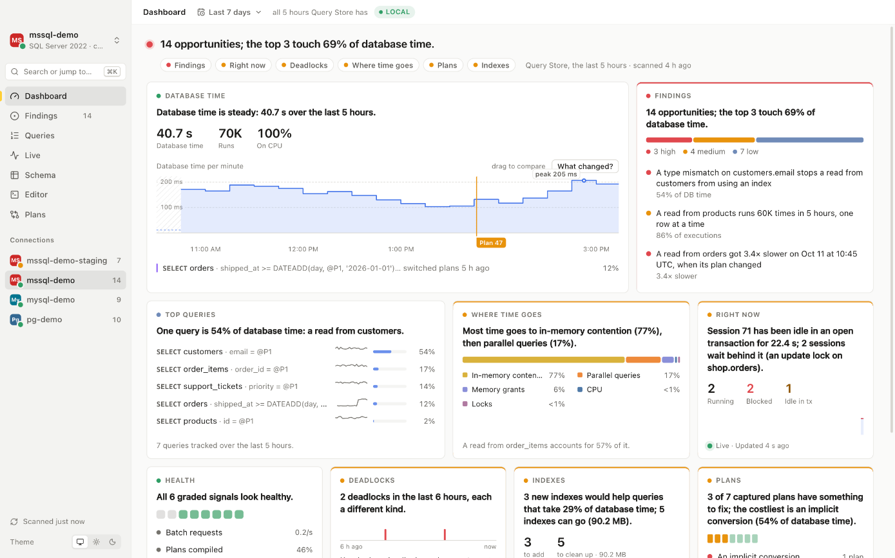
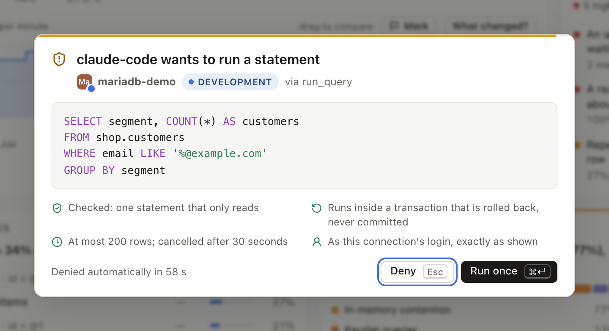
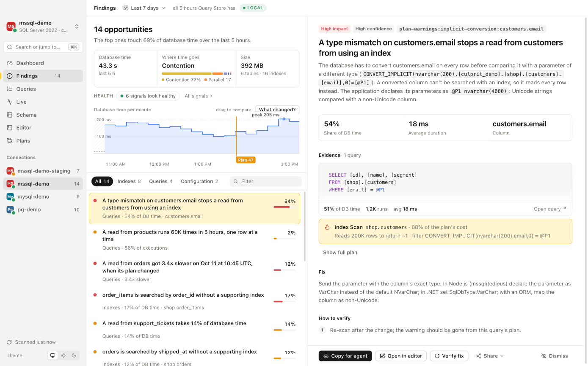
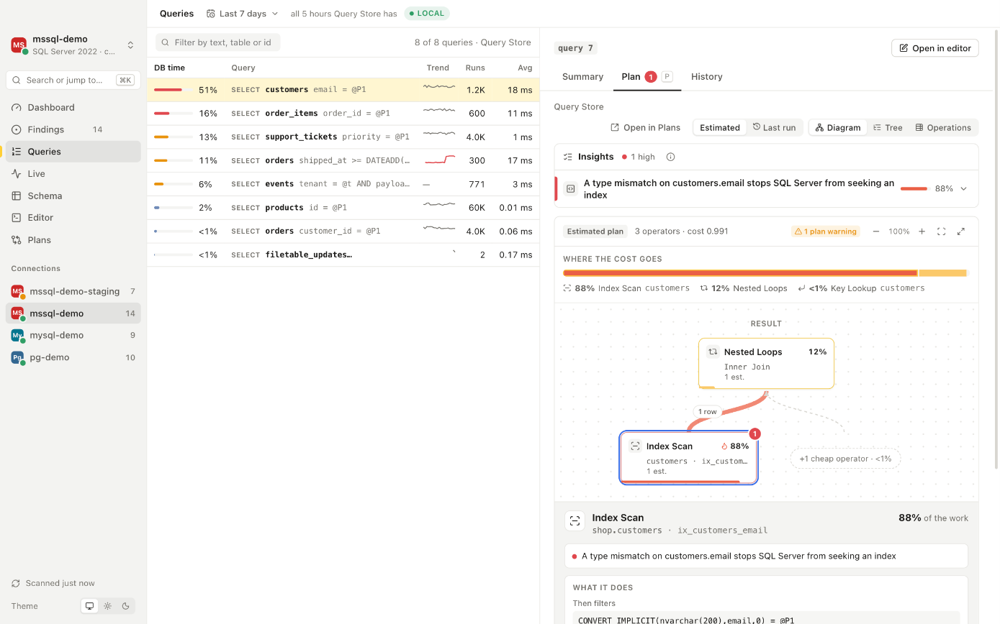
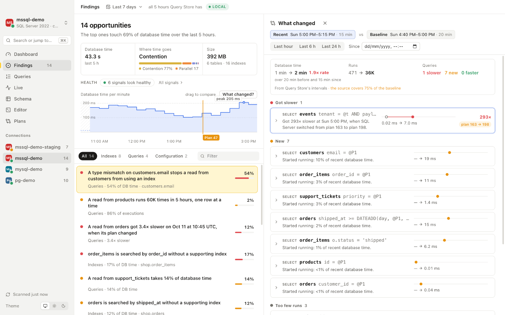
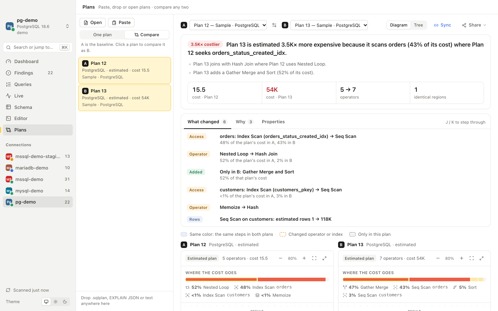
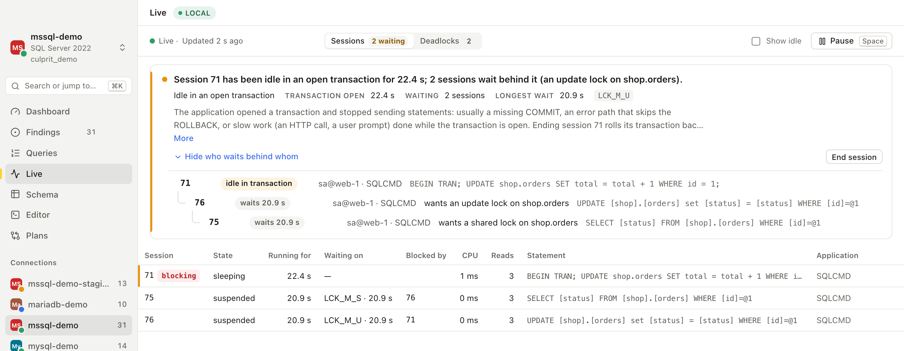

<p align="center">
  
</p>

<h1 align="center">Culprit SQL Studio</h1>

<p align="center">
  <b>Find out what's slowing your database down, and exactly how to fix it.</b>
</p>

<p align="center">
  A fast desktop app and CLI for SQL Server, PostgreSQL, TimescaleDB, YugabyteDB, MySQL, MariaDB and SQLite, on macOS, Linux and Windows.<br>
  Plain-language answers for people. Safe, structured access for coding agents.
</p>

<p align="center">
  
  
  
  
  
  
  
  
  
  <a href="https://github.com/cristipufu/culprit-sql-studio/actions/workflows/ci.yml"></a>
  <a href="LICENSE"></a>
</p>

<p align="center">
  <a href="https://culpritsql.com"><b>culpritsql.com</b></a> ·
  <a href="#why-culprit">Why Culprit</a> ·
  <a href="#coding-agents-and-ci">Agents &amp; CI</a> ·
  <a href="#what-you-get">What you get</a> ·
  <a href="#safe-on-production">Safety</a> ·
  <a href="#how-it-works">How it works</a> ·
  <a href="#get-started">Get started</a> ·
  <a href="docs/guide.md">Guide</a>
</p>

<br>

<picture>
  <source media="(prefers-color-scheme: dark)" srcset="docs/images/dashboard-dark.png">
  
</picture>

<br>

## Why Culprit

When a database gets slow, someone has to dig through Query Store, wait statistics, plan caches and execution plans to find out why. That takes an expert, an afternoon and a handful of tools that each show a piece of the picture.

Culprit does the digging in seconds. It reads the statistics your database already keeps, works out where the time goes, and tells you in one sentence what is wrong, what it costs and what to change:

> **Repeats its read of `order_items` 1.5M times, once per row of `order_items`.**<br>
> 27% of database time, and it times out on every run · **Fix:** the query forces a loop join; remove the hint and let the optimizer choose · **Verify:** run it with actual rows: a hash join, or far fewer executions of `order_items`.

<table>
<tr>
<td width="33%" valign="top">

**🎯 Answers, not raw numbers**

Every finding is ranked by its share of database time and comes with the evidence, a production-safe fix and a way to prove it worked.

</td>
<td width="33%" valign="top">

**🛡️ Safe on production**

Scans read statistics only and never run your queries. Anything that would change data on a production database asks first.

</td>
<td width="33%" valign="top">

**🤖 Built for coding agents**

An MCP server, JSON output everywhere and per-connection permissions let Claude Code, Cursor or Codex investigate with you. Every call is approved and audited.

</td>
</tr>
<tr>
<td valign="top">

**⚡ Fast and light**

A 14 MB app that opens in under a second and shows the last report instantly while a fresh scan runs in the background.

</td>
<td valign="top">

**🧭 One workflow across your databases**

The same views, wording and workflow on SQL Server, PostgreSQL, TimescaleDB, YugabyteDB, MySQL, MariaDB and SQLite. When an engine can't show something, Culprit says why in one sentence.

</td>
<td valign="top">

**🔌 Open and pluggable**

Add your own checks or database engines without forking. The app, the CLI and the agent tools share one Rust core.

</td>
</tr>
</table>

## Coding agents and CI

Culprit is designed to be driven by a coding agent or a CI script as comfortably as by a person. Every CLI command prints JSON when piped (or SARIF 2.1.0 with `--format sarif`), and finding ids are stable across runs.

### Coding agents (MCP)

`culprit mcp` serves 27 tools over the Model Context Protocol: dashboard, findings, plans, plan insights, migration linting, schema drift, what changed, blocking, waits, index advice, verification and more. When queries carry `file:line` comments (Marginalia, SqlCommenter or `/* app/models/order.rb:42 */`), each finding's brief points straight to the call site in your repository.

```sh
claude mcp add culprit -- culprit mcp   # Claude Code; Cursor and Codex take the same command
culprit agent init                      # teach agents in this repository to use Culprit
```

From the terminal, you can also print a finding's brief directly or test a proposed index without building it where the provider supports `hypopg`:

```sh
culprit show shop 'filtered-scan:public.orders'
culprit explain shop --sql "SELECT * FROM orders WHERE status = 'open'" \
  --with-index "CREATE INDEX ON orders (status ASC)"
```

You decide what agents may do, per connection: nothing, read statistics and plans (the default), or run read-only queries that you approve one by one. Approval shows the exact statement and what Culprit guarantees about it, and every tool call lands in a local audit log.

<p align="center">
  <picture>
    <source media="(prefers-color-scheme: dark)" srcset="docs/images/agent-approval-dark.png">
    
  </picture>
</p>

### Pull requests and deploy pipelines

`culprit lint-sql` checks migration files offline against a saved snapshot, using the database's actual table sizes, column types, indexes and active workload to catch blocking `CREATE INDEX`, `DROP INDEX` and `ALTER TABLE` locks, unindexed or type-mismatched foreign keys, and `DROP` or `RENAME` changes that break live queries:

```sh
culprit lint-sql shop --file migrations/ --fail-on high             # exit 3 on high-severity findings
culprit lint-sql shop --file migrations/ --write                    # add CONCURRENTLY / ONLINE = ON / LOCK=NONE in place
culprit lint-sql shop --file migrations/ --format sarif > db.sarif  # SARIF 2.1.0 for GitHub Code Scanning
```

```yaml
# .github/workflows/db-check.yml
- name: Lint migrations against production snapshot
  run: culprit lint-sql prod-snapshot.json --file migrations/ --format sarif > culprit.sarif
- uses: github/codeql-action/upload-sarif@v3
  with:
    sarif_file: culprit.sarif
```

After a deploy, mark the timeline so regressions line up with the release, and re-scan to verify that a fix worked:

```sh
culprit mark shop deploy v2.4.0                       # put the deploy on the database timeline
culprit verify shop 'filtered-scan:public.orders'     # exits 2 if the finding is still present
culprit digest shop > digest.json                     # redacted JSON summary for Slack or Teams
```

## What you get

### Findings you can act on

68 checks look for what actually costs time: runaway loops in plans, plan regressions, missing and unused indexes, N+1 query loops, type mismatches that block indexes, parameter-sensitive plans, queries that fail or time out, spills to disk, hot rows, statements that lock a whole table, unindexed foreign keys, sequence and transaction-ID exhaustion, partition hazards, page checksum corruption, slow storage, connection storms, replication lag, stale statistics, risky settings and more. Each finding names the queries involved, shows their share of database time, and ends with a fix you copy (Culprit never applies it for you) and a way to verify it.

<picture>
  <source media="(prefers-color-scheme: dark)" srcset="docs/images/findings-dark.png">
  
</picture>

### Plans that explain themselves

Every captured plan comes with insights in plain words ("repeats its read of order_items 1.5M times, once per row"), a diagram that shows where the cost goes, and the operator's details one click away. 35 rules cover SQL Server, PostgreSQL (including TimescaleDB), YugabyteDB, MySQL, MariaDB and SQLite plans. Measure a run safely (writes are rolled back), and on SQL Server see the last actual plan without re-running the query or watch a long query's progress step by step.

<picture>
  <source media="(prefers-color-scheme: dark)" srcset="docs/images/queries-dark.png">
  
</picture>

### "What changed?" in one drag

Drag across the database-time chart to compare two periods. Culprit lists what got slower, what's new and what improved, and says why: "Got 293× slower at 5:00 PM, when SQL Server switched from plan 163 to plan 198." It also lines regressions up with everything else that changed around them: a dropped index, a new setting, a restart, a deploy your pipeline marked with `culprit mark`, or the cloud throttling the server (Amazon RDS CPU credits running out, Azure tier limits), read with your own `aws` or `az` sign-in.

<picture>
  <source media="(prefers-color-scheme: dark)" srcset="docs/images/what-changed-dark.png">
  
</picture>

### Compare any two plans

Paste or drop a plan from anywhere (SSMS `.sqlplan`, PostgreSQL `EXPLAIN`, YugabyteDB `EXPLAIN (ANALYZE, DIST, FORMAT JSON)`, MySQL `EXPLAIN FORMAT=JSON`) and compare it with another. The headline says what matters: "Plan 13 is estimated 3.5K× more expensive because it scans orders where Plan 12 seeks orders_status_created_idx." Every changed step is marked in both diagrams.

<picture>
  <source media="(prefers-color-scheme: dark)" srcset="docs/images/compare-dark.png">
  
</picture>

### Who is blocking whom, right now

Live sessions turn a wall of lock waits into one sentence and a tree: which session holds everyone up, why (here: a transaction left open by the application) and who waits behind it. Deadlocks get the same treatment, with the pattern named and the fix spelled out.

<picture>
  <source media="(prefers-color-scheme: dark)" srcset="docs/images/live-dark.png">
  
</picture>

### And everything else, done properly

| Feature | What it does |
|---|---|
| **Index advisor** | Indexes to add, ranked by the database time of the queries that need them, plus duplicate, overlapping and unused indexes to clean up, with what each costs on writes |
| **Migration linter** | Live inline warnings and one-click quick fixes in the SQL editor, plus `culprit lint-sql` to check migration files offline against your snapshot |
| **Where time goes** | Wait statistics in plain words, traced back to the queries behind them, with a live sample to compare against the usual mix |
| **Health signals** | Memory, compiles, connections, row locks, storage latency per file, replication lag and cloud limits, each graded with a one-line takeaway |
| **SQL editor** | Tabs, autocomplete for schemas, tables and columns, saved queries, and estimated and measured plans. Reads run read-only; production changes ask first |
| **Schema explorer** | Tables, sizes, indexes and how each index is used, plus drift between two environments (columns, indexes, foreign keys, triggers, check constraints and partition bounds) with the SQL to close the gap |
| **Connections** | Paste any connection string, discover Azure and AWS databases with your existing CLI login, or import from Azure Data Studio, VS Code, DBeaver and DataGrip. Use an [SSH jump host](docs/ssh.md) for private databases. Passwords stay in your OS keychain |
| **Keyboard first** | A command palette (⌘K) for every view, finding, query and action |

## Safe on production

- **Read-only by design.** Scans read statistics and catalog views only, with short lock timeouts. Estimated plans never execute anything.
- **Planning never lends your privileges.** On PostgreSQL and YugabyteDB, planning can invoke functions. Elevated logins plan only their own recorded statements, and none while functions other roles wrote are in reach. Every plan is made in a read-only transaction that is rolled back.
- **Production is guarded.** Statements Culprit can prove only read run in a read-only transaction. Anything else on a production connection needs an explicit confirmation that says what it will do, and destructive statements need the connection's name typed.
- **Fixes are suggestions.** Every fix is shown and copied, never applied, and uses online or concurrent operations where the server supports them.
- **Secrets stay put.** Passwords live in the OS keychain, Entra ID uses your `az login`, and nothing about your servers leaves your machine. Exports redact literal values by default.
- **Agents get least privilege.** Off, statistics only, or approved read-only queries, per connection, with every call audited.

## Supported databases

See [Engine parity](docs/parity.md) for the feature comparison and each provider's setup, measurements and verified versions.

| Database | Where the answers come from |
|---|---|
| **SQL Server / Azure SQL** | Query Store, plan cache, DMVs and retained deadlock events |
| **PostgreSQL / Amazon RDS** | `pg_stat_statements`, catalog/statistics views, EXPLAIN and HypoPG |
| **TimescaleDB** | PostgreSQL sources plus logical hypertable sizes and managed/compressed chunks |
| **YugabyteDB** | Native YSQL/DocDB counters, DIST plans, sharding and scoped activity sources |
| **MySQL** | `performance_schema`, `sys`, EXPLAIN and the slow query log |
| **MariaDB** | Performance schema, slow log, user statistics, MariaDB plans and lock views |
| **SQLite** | Read-only file/catalog inspection, `EXPLAIN QUERY PLAN` and optional framework query logs |

When a source is switched off (Query Store, `pg_stat_statements`, `performance_schema`), Culprit shows the one statement that turns it on and what you'll get once it's on.

## How it works

```text
Sources ──► Snapshot ──► Prepare ──► Detect (68 checks) ──► Refine ──► Rank ──► Views
```

- **Offline-first snapshots (`culprit-core`).** Collectors read catalog and statistics views into a self-contained `Snapshot`. Every check, view, diff and migration lint is a pure function of that snapshot—replayable offline in CI or on another machine without a database connection.
- **Evidence rules, not guesses (`culprit-checks`).** Checks never flag a query from a plan's shape alone when the server has runtime counters. Rates require at least an hour of counter history, "unused" index claims require a week, unavailable sources lock their dependent checks instead of reporting zero issues, and the refinement pass merges related symptoms into one root-cause finding.
- **One declarative spec per engine (`EngineSpec`).** Capabilities, SQL dialect rules, setting thresholds and refusals live in one spec per engine (`crates/culprit-core/src/engines/`), shared by the Rust analyzer and the TypeScript UI.
- **Embeddable Rust workspace.** The core model (`culprit-core`), analyzer (`culprit-checks`), workspace and secrets engine (`culprit-engine`), query-log parser (`culprit-querylog`), MCP server (`culprit-mcp`), CLI (`culprit-cli`) and engine providers (`culprit-postgres`, `culprit-mssql`, `culprit-mysql`, `culprit-sqlite`, `culprit-yugabyte`) can be embedded as a library, with custom `Check`s or runtime providers plugged in without forking.

## Get started

Download the desktop app (`.dmg` for macOS, installer for Windows, `.AppImage` or `.deb` for Linux) and the standalone CLI from the [latest release](https://github.com/cristipufu/culprit-sql-studio/releases/latest). The desktop app checks for a new release once a day and offers it at the foot of the sidebar; it installs only an update signed with Culprit's key, and restarts when you choose (turn the daily check off from the command palette). A downloaded CLI keeps itself current with `culprit update`, which replaces it with the latest release after checking its SHA-256; the CLI never checks on its own.

To build from source instead, you need [Rust](https://rustup.rs) (stable) and [Bun](https://bun.sh); on Linux, also the WebKitGTK development packages listed in the [guide](docs/guide.md#platforms).

```sh
git clone https://github.com/cristipufu/culprit-sql-studio.git
cd culprit-sql-studio

cargo build --release -p culprit-cli           # the culprit CLI, in target/release
cd app && bun install && bunx tauri build      # the desktop app
```

Connect a database and get its dashboard:

```sh
culprit conn add shop --env staging --url 'postgres://app@db.example.com:5432/shop'
culprit dashboard shop       # the database at a glance
culprit scan shop            # every finding, ranked
```

Or open the desktop app, pick the engine and paste its connection string (or choose the SQLite file), and the first report appears in seconds.

**Just looking?** `cd app && bun install && bun run dev` opens the full interface in your browser with demo data: no database needed.

## Learn more

- **[Guide](docs/guide.md):** every check and command, the agent setup, measured speed, safety details and how to extend Culprit
- **[Architecture](docs/ARCHITECTURE.md):** the analysis pipeline, the evidence rules every check follows and the crate map
- **[Design](docs/DESIGN.md):** how the product behaves and why
- **[Coding agents](docs/agents.md):** MCP tools, permissions, approvals and the audit log
- **[Engine parity](docs/parity.md):** feature comparison, provider guides, setup and verified versions

Culprit is open source under the [MIT license](LICENSE).

<br>

<p align="center">
  <br>
  <sub>Made for the people who get paged when the database is slow.</sub>
</p>
