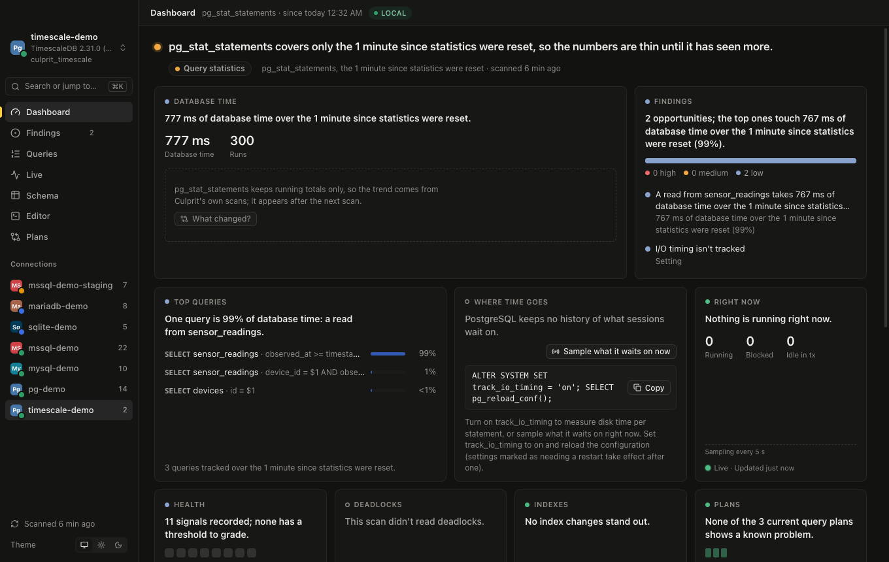
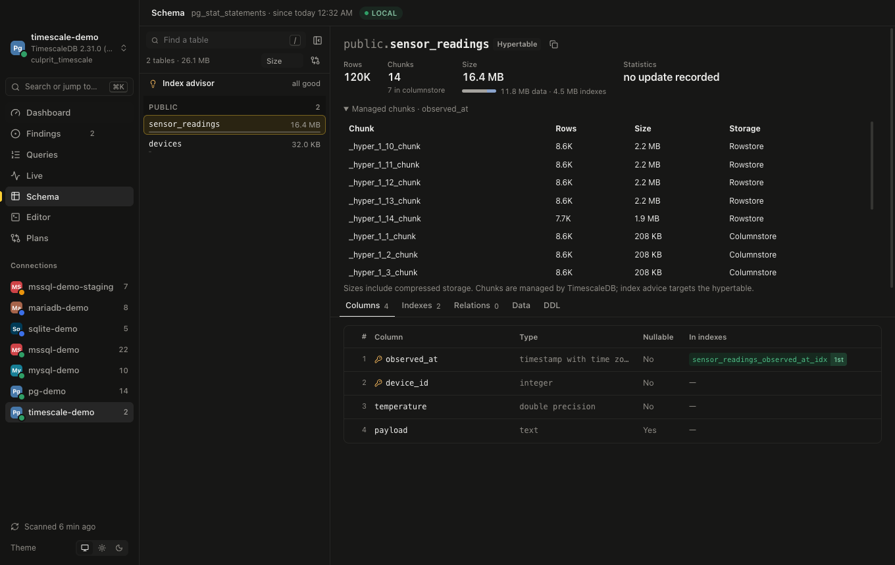

# TimescaleDB

[Engine parity](../parity.md)

Culprit detects TimescaleDB through its PostgreSQL provider and reads the extension's public information and size APIs. Hypertables and managed chunks retain their own storage semantics.

## Connecting

Choose **PostgreSQL** when connecting to TimescaleDB or Tiger Cloud. Culprit detects the `timescaledb` extension and displays its version alongside PostgreSQL's version. PostgreSQL connection strings, TLS settings, password/keychain handling, query execution, live sessions, explain/analyze, saved scans, exports and plan comparisons use the PostgreSQL provider.

```sh
culprit conn add metrics --env staging --url 'postgres://app@db.example.com:5432/metrics'
```

## Permissions and setup

Use PostgreSQL monitoring access such as `pg_read_all_stats` or `pg_monitor`, plus access to the extension's information views and public size functions. `pg_stat_statements` supplies the PostgreSQL workload counters when installed and available.

Culprit detects the existing `timescaledb` extension and its installed schema. A missing or denied extension source records its own coverage reason. It does not install the extension, create hypertables or manage the application's TimescaleDB jobs.

## Workload and plans

Statement statistics, fingerprints, timelines and saved-scan comparisons use the [PostgreSQL workload sources](postgres.md#workload-and-plans). They keep the statement counters' own period, not a period inferred from chunk creation or compression.

PostgreSQL EXPLAIN and explicit measured runs use the PostgreSQL provider. Plan preparation links physical chunk reads to their owning hypertable so the advisor can target the logical object. An unknown managed chunk receives no guessed index script. Plan import, comparison and sharing use the same engine-neutral workflow.

## Live activity and waits

Sessions, blocking chains, cancellation, live session sampling and PostgreSQL progress views use the [PostgreSQL live sources](postgres.md#live-activity-and-waits). They do not constitute a TimescaleDB policy or job history.

A deadlock counter remains PostgreSQL's database counter; reconstructing a deadlock pattern requires the relevant server-log records. Managed-service restrictions can make individual sources unavailable.

## Schema and indexes

Culprit reads the extension's public `timescaledb_information.hypertables`, `dimensions`, and `chunks` views, plus `approximate_row_count`, `hypertable_detailed_size`, `chunks_detailed_size`, and `hypertable_index_size` in the extension's installed schema. Each source has its own coverage result; a permission or version error becomes a visible note.

The Schema view lists the logical hypertable once. Its row estimate and storage include its managed chunks, including compressed storage. Expand **Managed chunks** for each chunk's row estimate, size and rowstore/columnstore state. Large chunk lists initially render 20 rows and expose 20 more at a time.

Physical chunks are associated with their owning hypertable in plan analysis. Actionable index advice targets the hypertable, using `WITH (timescaledb.transaction_per_chunk)` for non-unique indexes. Ordinary tables retain PostgreSQL's concurrent index syntax. Unique index drift scripts require every collected partition dimension. TimescaleDB's [per-chunk index builds](https://github.com/timescale/Tiger-Data-Docs/blob/main/src/content/docs/reference/timescaledb/hypertables/create_index.mdx) can still block operations on the chunk currently being indexed; they are not lock-free.

## Limits and evidence

- Parent `pg_stat_user_tables` and `pg_stat_user_indexes` counters do not measure all chunk activity. Logical hypertable scans, writes, vacuum/analyze timestamps and index usage are unknown. Culprit does not call a parent index unused based on its empty counters. Index sizes use TimescaleDB's aggregate API.
- `_timescaledb_*` storage, compressed implementation tables and continuous-aggregate materializations are not independent application tables. They are excluded from standalone schema/index/maintenance advice. Continuous aggregate definitions, jobs, retention/compression policies, columnstore-specific sparse indexes and columnstore tuning are not managed by Culprit.
- When the native hypertable catalog cannot be read, Culprit withholds potentially misleading table/index measurements, explains the missing source, and avoids concurrent index DDL on unresolved tables. When only chunk details fail, logical totals remain available but an unidentified internal chunk receives no index script.
- Row counts are estimates, not `COUNT(*)`. Sizes describe storage allocation, not an estimate of reclaimable space. PostgreSQL database-wide vacuum/freeze and operational measurements remain relevant; heap measurements from an empty logical parent are not graded as hypertable health.
- The DDL tab does not pretend an ordinary `CREATE TABLE` can recreate a hypertable. Use a TimescaleDB-aware schema export for partitioning, compression and policies.
- Legacy distributed hypertables and older extension versions have not been verified. Missing APIs follow the same partial-coverage path rather than substituting parent heap measurements. Managed-service permission restrictions may also make individual sources unavailable.

The shared [evidence rules](coverage.md) apply to PostgreSQL sources and extension-specific measurements.

## Verification

Local verification used TimescaleDB **2.31.0** on PostgreSQL **17.11**, including real hypertables, compressed chunks and an ordinary table. Tiger Cloud hostnames are recognized, but a hosted Tiger Cloud account has not been tested. [Reproduce the local database and workload](../../dev/timescale/README.md).

The captured example has `public.sensor_readings` with **120,000 rows, 14 chunks and seven compressed chunks**, plus `public.devices`. `fixtures/timescale-demo.report.json` contains the actual collected input and today's analysis. The development browser renders this saved report without a database connection.

The extension collector is [`culprit-postgres/src/timescale.rs`](../../crates/culprit-postgres/src/timescale.rs); its sources are declared alongside the PostgreSQL sources.

### Screenshots

These are actual rendered views of the live-collected report, with its own captured sessions rather than another demo database's activity:




