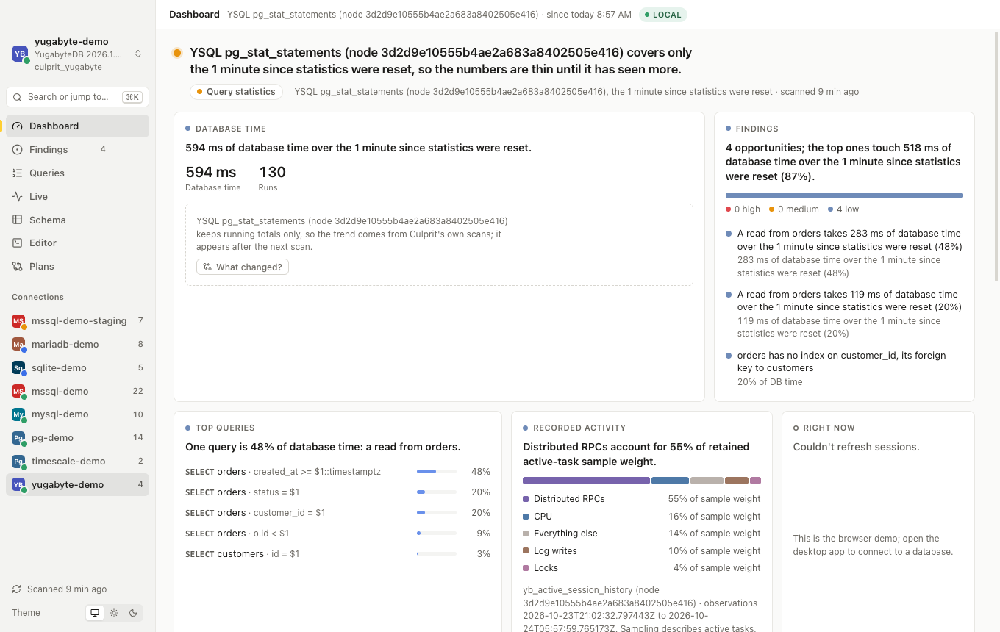
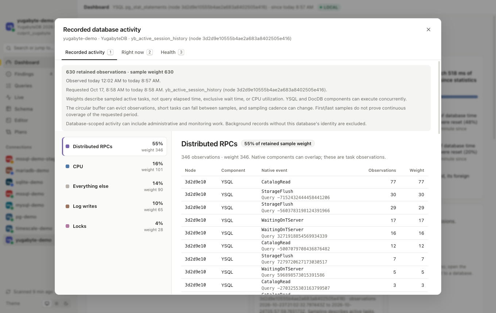
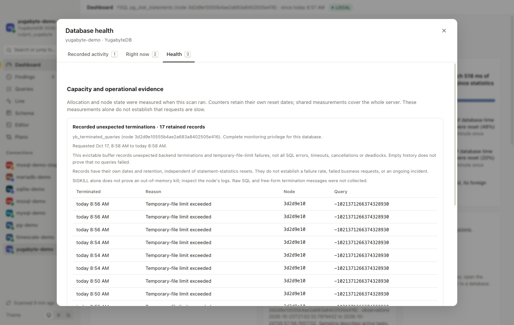
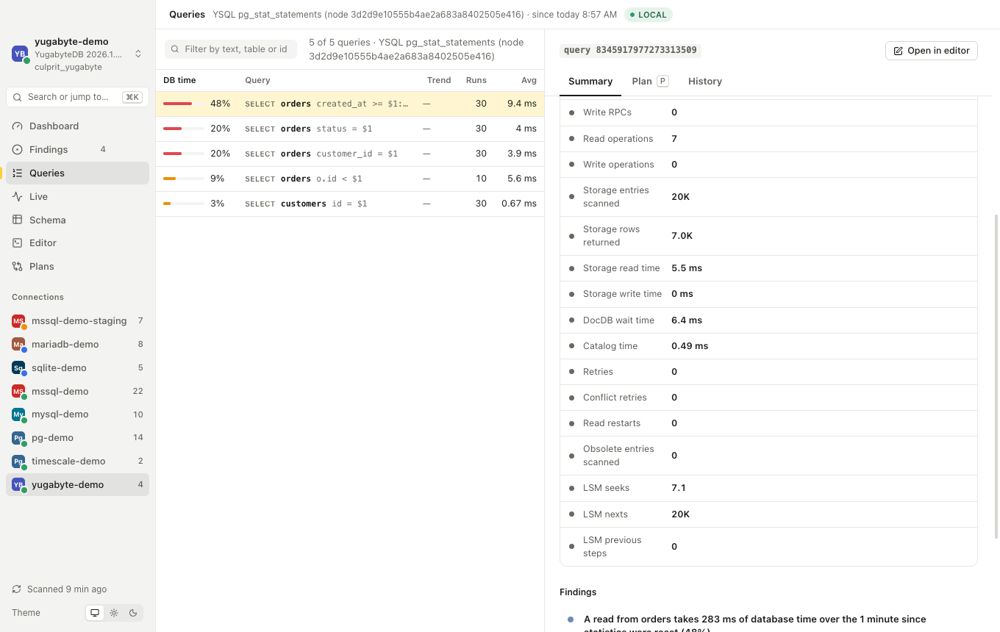
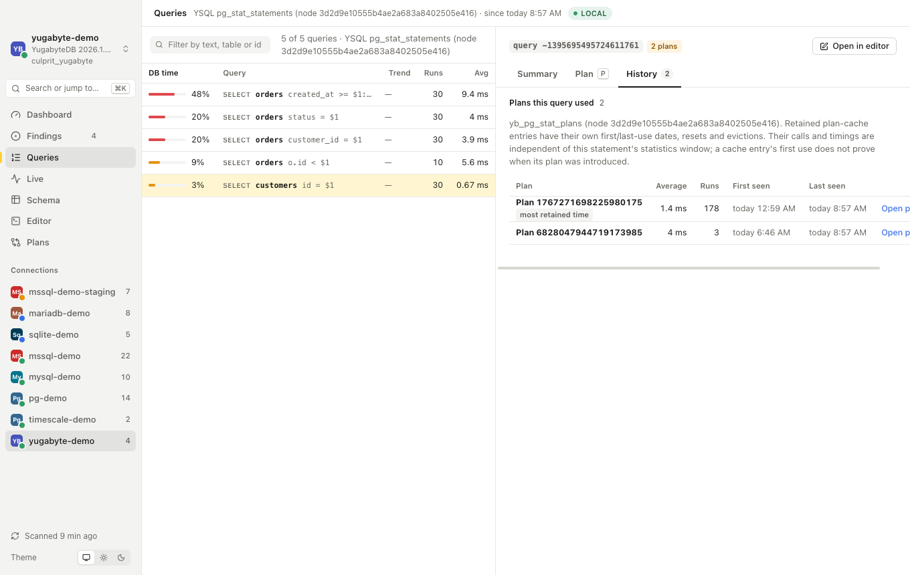
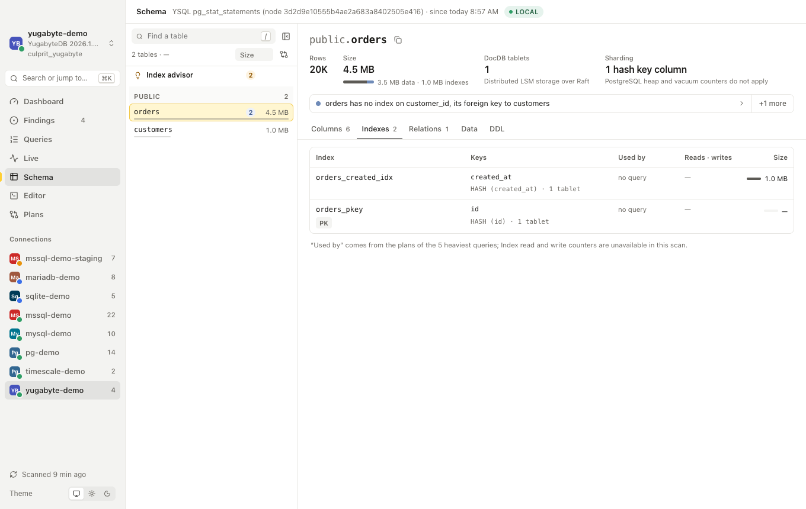

# YugabyteDB

Culprit has a dedicated `yugabyte` provider for YSQL over DocDB. PostgreSQL supplies the wire transport and SQL grammar;
its heap, buffer-cache and vacuum collectors are not used. This support is in the development tree after 0.4.4.

Choose **YugabyteDB** before pasting a PostgreSQL URL, or use a native URL:

```text
yugabyte://app@db.example.com:5433/shop
```

The CLI accepts `--engine yugabyte` (`ysql` and `yugabytedb` are aliases). The defaults are port 5433 and user/database
`yugabyte`. Passwords use the existing OS-keychain flow. Remote TLS verifies the server unless the connection explicitly
requests another mode. Azure Entra and RDS IAM bearer tokens are refused for this provider.
The PostgreSQL provider recognizes a YugabyteDB server before calling storage APIs and asks you to select YugabyteDB,
so a PostgreSQL URL cannot silently enable heap-oriented collection on DocDB.

Verified against **YugabyteDB 2026.1.2.0-b137**, whose YSQL server identifies as **15.12-YB-2026.1.2.0-b0**. Older releases
are not claimed as verified; optional views and functions that are absent or denied become coverage notes.

## Measurements and scope

| Area | Current implementation |
|---|---|
| Connection test | Version, database identity, clock and feature availability; no `pg_database_size` call |
| Workload | Database-filtered `pg_stat_statements`, aggregated by query identity; top queries retain totals for the complete source |
| Native costs | DocDB RPCs, storage operations/entries, timings, retries and LSM traversal counters, only for metric families enabled on every contributing node |
| Captured plans | Safe generic/estimated YSQL plans; elevated logins plan their own recorded text, including their copy on another node when global views are configured |
| Retained plan history | Native `yb_pg_stat_plans` cache counts, weighted average/max elapsed times and first/last use; selected cached bodies stay in saved scans for offline inspection |
| Analyze | `EXPLAIN (ANALYZE, DIST, VERBOSE, FORMAT JSON)`; measured writes roll back |
| Plan files | Native JSON with DIST/storage markers is detected as YugabyteDB; saved scans reparse with the native reader |
| Catalog | Tables, row estimates, columns, defaults, foreign keys, index definitions, hash keys, tablet counts and colocation |
| Deferred constraints | CHECK and foreign-key constraints added NOT VALID; findings explain unvalidated existing rows and suggest version-appropriate validation, without PostgreSQL planner or locking promises |
| Sizes | Native table/index size APIs, separately from the cheap probe; primary-key storage is part of the table; colocated objects are not charged their shared tablegroup's allocation |
| Index advice | Ordered candidate keys use explicit ASC/DESC; HASH groups differ from range keys in redundancy, lookup coverage and drift; active backfill must finish before repairing an invalid index |
| Index usage | Complete global index counters when available; no unused-index verdict from a local zero or unknown reset date |
| Live | Current-database sessions and native `yb_lock_status` blocking evidence; node-qualified identities include backend start time |
| Live samples / progress | Bounded session sampling with native RPC/storage categories; scoped current activity and optional estimated plans; supported CREATE INDEX / ANALYZE phases without guessed percentages |
| Activity history | Database- and role-scoped native ASH observations, with task weights, observation nodes, component/event names and query identities in an independent retained period |
| Unexpected terminations | Native `yb_terminated_queries` records, with query IDs, recognized reasons, dates and nodes; database-filtered, with native login visibility and bounded retention |
| Session actions | Non-production only; local node, database and backend-start guards; Connection Manager worker backends are refused |

Workload retention streams at most 8 MiB of statement text and counters, without whole-row latency-histogram expansion.
An oversized response retains a contiguous prefix and records partial coverage; no retained totals means unknown
workload rather than a zero. Completion and late errors are still read after retention stops.

The plan-capture phase has one 20-second budget and retains at most 8 MiB of native plan/statement text across current
estimates and retained cache plans. History metadata retains at most 1,000 entries and 8 MiB; collection fetches one
dominant retained body for each requested query in a single bounded read. `--plans 0` keeps metadata without fetching
bodies. Remaining statements can be planned on demand. Operator DIST counters are per-loop averages; normalized row counts multiply by
executions once. Storage entries can include index and table reads of the same SQL row. Native timings may overlap;
they are not PostgreSQL page counts, CPU utilization or exclusive shares of statement time.

Saved-scan plan context uses the catalog's logical YSQL row estimates, without heap-page inference. Native optimizer
costs have no calibrated materiality threshold in Culprit: a large or small cost number alone does not establish
expensive or cheap work. Measured operator work and elapsed time remain separate from those estimates.

Without `pg_read_all_stats`, statement totals are filtered to the current role before aggregation and labeled with that role scope. Hidden queries never become an invented query group.

## Retained plans

[Query Plan Management](https://docs.yugabyte.com/stable/launch-and-manage/monitor-and-alert/query-tuning/query-plan-manage/)
keeps an independent, evictable cache. Its counts and elapsed times have their own first/last-use dates, resets and
evictions; they do not share `pg_stat_statements`' counter epoch. Culprit shows those entries in Queries → History,
without turning a cache entry's first use into a plan-change event or attributing the statement's runtime to it.
The Plan tab initially shows the current safe estimate. Choosing a retained plan shows its cached tree instead.
The selected cached body in a saved scan opens offline, including after eviction from the database cache.

Retained bodies need complete JSON in the existing `yb_pg_stat_plans_plan_format` configuration. Text, XML, YAML or
truncated bodies remain unavailable with a reason. Native cached trees redact original constants and can omit row
estimates, execution counts and optimizer costs; these stay unknown. No measured operator counters, current-catalog
row counts or index-fix SQL are borrowed from the current workload. Collection never selects execution parameters
or hints, and tagged monitoring statements opt out of QPM tracking with the native skip comment.

Plan-cache reads require an effective `pg_read_all_stats` privilege (or superuser). Membership without inheritance is
insufficient. On the verified **2026.1.2.0-b137** release, an unprivileged native cache read crashes that backend in
`yb_pg_stat_plans_get_all_entries`, even with a `userid` filter. Culprit checks the effective privilege before any
cache read and records unavailable coverage instead; ordinary role-scoped statement collection still works.
An administrator can grant the monitoring role outside collection. Culprit never grants it or enables QPM itself.

Ordinary statistics are **node-local**. The scope is visible in the workload source and coverage notes. Culprit does not
enable or configure the optional [cluster-wide database views](https://docs.yugabyte.com/stable/launch-and-manage/monitor-and-alert/cluster-wide-db-views/)
preview during a scan. When an administrator has enabled it and granted access, the provider reads the existing global
views and verifies the node inventory. Warnings, skipped contributors, membership changes or independent resets withdraw
complete comparisons. Per-node reset timestamps retain microsecond precision. Culprit's scans compare only matching
node sets and reset generations.

The default global views do not include statement reset metadata or metric settings. An administrator can configure
corresponding global views outside a Culprit scan:

```sql
SELECT yb_create_global_view('public', 'pg_stat_statements_info');
SELECT yb_create_global_view('public', 'pg_settings');
```

Culprit accepts these custom views only through `yb_global_views_server` and with a superuser owner. Global views need
`pg_read_all_stats`; availability and permissions are checked by reading them. Native cost totals describe recorded
work; enabling collection later does not reconstruct older work.

YugabyteDB can record SQL generated inside its size functions and global-view implementation without the caller's
query tag. Those monitoring statements can therefore appear in statement totals; Culprit's application-query checks
exclude catalog and monitoring text. Culprit does not change the cluster's statement-tracking configuration.

A global database reset date can be NULL. That means unknown, even on a long-running node. Index absence requires at
least a week since every contributing node's proven database reset; differing known epochs can bound absence but do
not supply a common denominator for positive-rate calculations.

## Active Session History

[Native ASH](https://docs.yugabyte.com/stable/launch-and-manage/monitor-and-alert/active-session-history-monitor/)
records task observations and inverse-sampling weights. Culprit shows their distribution as **Recorded activity** in
the dashboard and waits panel, and through `culprit waits` and the MCP waits tool. Query links use only matching
statement identities; queries outside the collected workload remain identified without borrowed runtime statistics.
Event groups are paginated in the desktop, and agent output includes bounded event/query summaries.
Each event's node identifies the ASH buffer that supplied it, which can differ from the query's coordinating node.

The reader retains the newest 10,000 observations or 8 MiB of projected sample data, records partial reads, and honors
the requested scan period independently of `pg_stat_statements` resets. Local reads pass time bounds directly to the
native function. Existing global views receive constant database, role and time filters; Culprit never enables them.
Without the effective monitoring privilege, local history is restricted to the current role before retention.
Client addresses, request IDs, process memory and auxiliary event text are not collected.

Weights are **not elapsed query time, exclusive wait time or CPU utilization**. YSQL and DocDB components may run
concurrently. Sampling cadence can change, short operations can be missed and the circular buffer can evict records;
first/last observations do not prove continuous coverage. Historical samples may include administrative work and
statements no longer in the statement-statistics cache. Unknown database identities are excluded. These observations
do not produce resource-pressure or query-regression verdicts. Current live samples remain a separate measurement.

Verified live: bounded local reads, query-ID/node correlation, role isolation, revoked monitoring grants and matching counts through one-node global
views. Multi-node failure and independent retention scenarios still require verification.

## Unexpected terminations

[Native termination history](https://docs.yugabyte.com/stable/explore/observability/yb-pg-stat-get-queries/) records
unexpected backend exits and temporary-file-limit failures. It does not count ordinary SQL errors, all cancellations
or distributed deadlocks. Culprit retains the newest 1,000 records or 8 MiB for the requested period, independently of
statement-statistics resets; node-local or configured global visibility is explicit. The complete source read,
including inventory and permission checks, has one 10-second deadline. The native buffer can evict older records,
so even a successful, untruncated read does not establish complete history. Empty history is not a healthy
error-rate verdict. SIGKILL alone does not identify an OOM killer; correlate the dated record with the node's logs.

Only query IDs, recognized reason codes, timestamps and nodes leave the server. Raw SQL, backend PIDs and arbitrary
termination messages are omitted. Native permissions control which records the login can see; inherited role
privileges may expose records from other roles. A change to effective monitoring privilege during a read rejects
the result. Records may include administrative and monitoring connections. Health shows the retained records with
pagination; the dashboard, CLI and agent tools preserve their
scope and limitations. Records outside the retained workload remain identified without borrowed runtime statistics.
Global termination reads require effective monitoring privileges; restricted logins retain node-local native
visibility even when global views are configured, with the fallback stated explicitly.

Verified live: temporary-file-limit failures from bounded disposable sorts, database isolation, restricted-login
visibility, changed privileges, query-ID correlation and matching one-node global reads. No backend crash is induced
by this verification. Multi-node failure and retention scenarios remain unverified.

## Limits

PostgreSQL heap pages, buffer ratios, dead tuples, HOT updates, autovacuum, XID/MultiXact wraparound and heap-oriented GUC
advice are unavailable by design. Database size remains unknown. Configuration suggestions are restricted to supported
YSQL database settings; other changes use YugabyteDB administration rather than PostgreSQL `ALTER SYSTEM` guesses.

The current provider does not yet collect complete native operation progress,
server resource pressure or distributed error/deadlock history. These are implementation gaps;
PostgreSQL placeholders are not substituted. Current session/lock collection is limited to 1,000 sessions and 2,000
waits and labels truncated or node-local visibility incomplete. Live lowers the lock metadata reader's session-local
minimum transaction age to include young waiters; native transaction/per-tablet caps still limit its evidence. A no-blocking result is not a whole-cluster assertion
when visibility is incomplete. Remote sessions can be observed through global views, but actions require reconnecting
to their node. Logical Connection Manager clients are not identified by reusable physical backend PIDs.

Constraint metadata retains at most 10,000 rows and 8 MiB; truncation records partial coverage. On the verified release,
both CHECK and foreign-key [deferred validation](https://docs.yugabyte.com/stable/yugabyte-voyager/reference/non-superuser/)
were exercised against existing invalid rows and collected again after successful validation. Validation can scan
distributed data and acquire locks; review its behavior on the deployed YugabyteDB version before applying the fix.

Sequence capacity needs a native allocation-state source: `pg_sequences.last_value` returned NULL even for initialized
sequences on the verified release. The native implementation of
[`pg_sequence_last_value`](https://github.com/yugabyte/yugabyte-db/blob/master/src/postgres/src/backend/commands/sequence.c)
returns NULL instead of reading DocDB sequence state. Session-local `currval` and `lastval` cannot supply a cluster allocation watermark,
and a scan must not call `nextval` to discover one. No remaining-allocation estimate is inferred from those NULLs.

A plan without native storage markers is structurally indistinguishable from PostgreSQL JSON. Plans captured through
the YugabyteDB provider retain the correct engine; a plain external PostgreSQL-shaped plan needs native DIST output
for automatic detection. Approximate table DDL preserves known primary-key sharding and colocation, but tablespaces,
placement, tablegroups and range split boundaries require a native schema export before recreation.

The live global-view verification so far uses a one-node cluster. Multi-node failure/reset and Connection Manager
scenarios need additional verification before claiming that deployment coverage.

See [dev/yugabyte](../../dev/yugabyte/README.md) for the disposable database, seed workload and opt-in checks.

## Verified UI

These screenshots show the development UI reading the live fixture described above. They are not screenshots of the
published 0.4.4 build.







